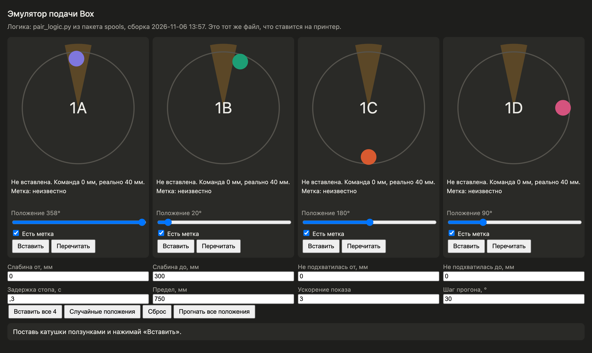

# Мультиподача

Пакет заменяет штатную подачу катушек в QIDI Box. Штатная прошивка подаёт вставленные катушки строго по одной и держит очередь команд, пока подача идёт. С пакетом все вставленные катушки подаются одновременно, а метки определяются прямо во время подачи.

## Что происходит при вставке

1. Пакет сам следит за датчиками слотов, поэтому вставленная катушка подаётся, даже если штатная прошивка не начала свою проверку. Так бывает, когда слот остался в состоянии «ждёт проверки»: тогда прошивка только проталкивает нить на 50 мм. Через 2 секунды после того, как датчик слота увидел нить, мотор делает короткий ход 30 мм вперёд и 10 мм назад, чтобы шестерня захватила нить. Назад меньше, чем вперёд: неглубоко вставленная нить не выходит из-под датчика.
2. Катушки едут к безопасной точке: 850 мм от места, где шестерня взяла нить, а если сплиттер этого слота уже замерен, на 250 мм раньше него. Дальше безопасной точки мотор вперёд не крутит, что бы ни хотел поиск метки. Сам поиск получает предел на 100 мм короче. По модели он раскачивал катушку за свой предел до 290 мм: с прежними 1000 мм это прямо сплиттер. У 1A 6 ноября сплиттер нашёлся уже на 963 мм.
3. По дороге считыватель ищет метки. Две метки одной катушки с общим номером катушки, как у Bambu или у двух меток, записанных в панели, считаются одной. На считывателе пара слотов: 1A и 1B, 1C и 1D. Метка приписывается катушке, только если появилась из пустой антенны, когда крутилась только она.
4. Если метку не удалось приписать сразу, одна катушка останавливается и коротко качается назад-вперёд, а вторая крутится дальше, пока метки не разведутся.
5. Если за безопасную длину метка не нашлась, катушка уходит назад на 104% оборота и возвращается, чтобы метка гарантированно прошла мимо антенны. Если поиску нужно дальше безопасной точки или он идёт дольше 120 секунд, он на этом заканчивается: остальные катушки пары доезжают до своей безопасной точки без поиска, а метки ищутся перечитыванием после замера до сплиттера.
6. Найденная метка записывается в слот: материал и цвет, их видно на экране принтера.
7. Если метка ответила своим номером, но прочитать её не удалось, она всё равно считается меткой этой катушки. В слот записывается номер метки и причина, материал и цвет слота не меняются. Если для этого номера в панели задана замена, слот получает материал и цвет из неё.
8. Метки, найденные при совместной подаче, считаются предварительными: 6 ноября 1A получила метку белой катушки из 1B с отметкой «появилась, когда крутилась только она». Окончательно метку даёт перечитывание после замера до сплиттера, см. ниже.

## Замер до сплиттера

Когда катушка дошла до безопасной точки, она встаёт в очередь к сплиттеру. Очередь идёт в порядке вставки, к сплиттеру едет только одна катушка, и только когда её сосед по считывателю стоит. Пока одна катушка перечитывается, к сплиттеру едет катушка другого считывателя, поэтому при вставке всех четырёх по порядку очередь выходит 1A, 1C, 1B, 1D, всего около двух минут. Мотор идёт со скоростью подачи короткими отрезками, датчик сплиттера проверяется каждые 20 мс, и как только он нажат, мотор останавливается. На 60 мм/с нить успевает пройти за датчик примерно на 30 мм, это учитывается при отводе. Если расстояние до сплиттера у слота уже известно, катушка проходит большую часть пути одним ходом и последние 120 мм отрезками.

- Так становится известно, где у этого слота сплиттер. Расстояние хранится в printer_data/config/box_feed_slots.json, по нему считается безопасная точка следующих подач этого слота, в том числе во время печати.
- После замера нить стоит в 200 мм от сплиттера, и пакет знает её точное положение. Выгрузка проходит эту длину быстро. Дальше этого места мотор катушку вперёд больше не крутит.
- После замера каждая катушка перечитывается, один раз: оборот назад и вперёд до места стоянки, соседняя катушка считывателя в это время стоит. Метка, найденная так, окончательная и заменяет найденную при подаче. Скорость оборота назад подбирается по тому, как часто считыватель успевает читать: метка должна быть у антенны хотя бы полтора промежутка между чтениями (ширина зоны антенны 40 мм взята из модели), от 10 мм/с до половины скорости подачи.
- Если метка, записанная в слот при подаче, оказалась на соседней катушке, слот очищается, как кнопкой «Забыть» в панели ({'empty': True}). Если перечитывание метку просто не увидело, она остаётся: при медленном чтении это ничего не доказывает.
- Если датчик сплиттера занят печатью или нитью в голове, замер ждёт, а перечитывание идёт сразу, от безопасной точки. Катушка, которая так осталась без метки, после замера перечитывается ещё раз: пока соседняя катушка стоит в голове, её метка может стоять у антенны, и тогда метку этой катушки не прочитать.
- Расстояние до сплиттера запоминается, только если пакет сам подал эту катушку и знает, где она стояла. После перезапуска Klipper нить всё равно доходит до датчика и встаёт в известное место, но в файл ничего не пишется.
- Длина трубки при выгрузке не измеряется: если нить застряла и её подтолкнули рукой, мотор насчитал бы лишнее.
- Если нить не дошла до датчика за 500 мм, она возвращается назад, а на экран выводится сообщение: значит, нить не захвачена или зацепилась.
- Замер идёт только тогда, когда принтер не печатает и не стоит на паузе, а датчик сплиттера свободен, то есть в голове нет нити. Очередь команд Klipper он не занимает, кнопки экрана работают. Выгрузка катушки, которая сейчас замеряется, останавливает замер, и выгрузка идёт с известного места.
- Пока замеряемая катушка у датчика или отъезжает от него, защита пары у других катушек датчик не слушает: он нажат не их нитью.
- 6 ноября все четыре слота прогнали на 500 мм вперёд и назад и записывали все датчики Box. Переключался только датчик сплиттера (b_endstop_state, 0 значит нажат). Второй датчик, e_endstop, стоит дальше по пути, и нить до него не дошла. Штатное движение до датчика (do_home) с подобранными аргументами нить у датчика не остановило, поэтому пакет им не пользуется.
- Изменения всех датчиков Box пакет пишет в klippy.log строками «bambu_rfid: sensors».

## Во время печати

Любой слот, кроме того, что сейчас печатает, работает как без печати: вставленная катушка подаётся, а выгрузка и «Перечитать» крутят только её мотор. Замер до сплиттера ждёт конца печати: датчик сплиттера в это время занят печатающей нитью.

- Печатающий слот с экрана, из Fluidd или панели не выгружается и не перечитывается, а загрузка в голову и выгрузка из головы во время печати не выполняются. Сама печать эти команды использует как обычно, а на паузе они работают штатно.
- Если печать дошла до смены цвета на слот, который пакет ещё подаёт, выгружает или перечитывает, печать встаёт на паузу. На экран выводится сообщение. После продолжения смена цвета выполняется заново; если слот всё ещё занят, печать снова встаёт на паузу.
- Метка катушки, которая стоит в слоте, но в этой подаче не крутится (заправлена в голову или подана раньше), соседней катушке не приписывается, даже если у антенны видна только она. В модели 1B получала метку 1A, стоявшей в голове. Мотор слота, заправленного в голову или занятого штатным кодом, пакет не крутит, даже если логике пары нужно отвести эту катушку от антенны.
- Чтобы кнопки экрана работали во время печати, в программе экрана снят ещё один бит маски кнопок (см. «Экран» ниже).

## Экран

Программа экрана QIDI_Client гасит кнопки Box по маске состояний. Это отдельная правка, не часть пакета: один байт в QIDI_Client/bin/qidiclient по адресу 0x109db0, оригинал лежит рядом в qidiclient.orig. Значение a1 вместо штатного e1 снимает «голова занята»: кнопки работают, пока крутятся моторы. Значение 21 снимает ещё и «идёт печать». Обновление прошивки QIDI возвращает оригинал.

## Уверенность в метке

| Уровень | Как метка определена |
|---|---|
| Перечитано | Найдена при перечитывании, крутилась одна катушка |
| Надёжно | Появилась из пустой антенны, крутилась одна катушка |
| Ушла с катушкой | Ушла из антенны вместе с этой катушкой или осталась, когда крутилась другая |
| Под вопросом | Две метки стояли рядом, их разводили |

Если двум катушкам досталась одна метка, перечитывается только менее уверенная. Если она находит ту же метку, перечитывается вторая.

## Перечитать

Кнопка «Перечитать» на экране для незаправленного слота с нитью запускает перечитывание пакета, а не штатное. Штатное гонит нить до датчика сплиттера и обратно, около 30 секунд, и всё это время держит очередь команд и остальные кнопки экрана. Перечитывание пакета: катушка уходит назад на 104% оборота и возвращается точно на место, дальше места стоянки вперёд не идёт. Если у антенны стоит метка соседней катушки, соседняя немного отходит назад. Крутится только эта катушка, остальные слоты в это время можно выгружать, загружать и перечитывать. Перечитать работает и для катушки, поданной до перезапуска Klipper или штатной подачей, если слот отмечен как готовый к печати: считается, что она стоит в безопасной точке. Если слот не подан, то есть не готов к печати и не подан пакетом, «Перечитать» подаёт катушку с начала, как при вставке. Иначе катушка ушла бы назад на длину подачи и выпала.

Пока пара ещё подаёт катушки, «Перечитать» на её слоте отвечает, что слот занят. Заправленный в голову слот и пустой слот перечитываются штатно.

## Выгрузка

Выгрузка незаправленного слота идёт только мотором, без движения головы. Длина, на которую пакет подал катушку, известна: её большая часть проходит одним быстрым ходом, последние 150 мм медленно, отрезками, пока датчик слота не покажет, что нить вышла. Если длина неизвестна, например после перезапуска Klipper, быстрым ходом проходит 850 мм. Если нить не вышла за 4000 мм, на экран выводится ошибка. Несколько слотов выгружаются одновременно. Заправленный в голову слот выгружается штатно.

## Режимы скорости

Настраивается в панели на вкладке «Мультиподача». Всё хранится в файле printer_data/config/box_feed.json, поэтому меняется и во время печати. Новые настройки действуют со следующей подачи, перечитывания или выгрузки. Команда `BOX_FEED_MODE MODE=quiet|normal|fast` меняет только режим, остальное в файле остаётся.

| Режим | Подача, мм/с | Выгрузка, мм/с | У датчика, мм/с | Разгон, мм/с² | Моторов сразу |
|---|---|---|---|---|---|
| Тихий | 30 | 40 | 20 | 50 | 2 |
| Обычный | 60 | 90 | 40 | 200 | 4 |
| Быстрый | 80 | 100 | 50 | 200 | 4 |
| Свой | 20–80 | 20–100 | 10–50 | 50–200 | 4, 3, 2, попарно, 1 |

Значения «Своего» режима, которые выходят за эти пределы, принтер сам приводит к ближайшей границе.

**Моторов сразу.** Слоты сверх предела ждут свободного мотора и начинают сами, как только он освободится. «Попарно» значит по одному мотору на считыватель: сначала 1A и 1C, потом 1B и 1D.

**Ночной режим.** В заданное время, например с 23:00 до 07:00, Box работает в тихом режиме, в остальное время в выбранном. Время берётся по часам принтера.

**Как принтер.** Если включено, Box работает тихо и тогда, когда на экране QIDI выбран режим печати «Silent (50%)», то есть скорость печати 50% и ниже.

Поиск меток проверен в модели на подаче от 30 до 100 мм/с. Штатная прошивка крутит моторы Box до 90 мм/с, разгон 50 мм/с². Выгрузка 100 мм/с быстрого режима на железе ещё не проверена.

## Защиты

- Если датчик слота перестал видеть нить, мотор сразу выключается, а слот освобождается: катушку можно вставить снова, и она подаётся заново, даже пока соседняя ещё едет.
- Когда нить вышла из слота, при выгрузке или если её вытащили, слот отмечается пустым (`slot<N>` = 0), а известная длина подачи забывается.
- Обратный ход не идёт ближе 60 мм к датчику слота.
- Штатный код и пакет никогда не крутят один мотор одновременно. 5 ноября штатная загрузка слота 1A началась посреди нашей выгрузки этого же слота, и Klipper остановился с ошибкой «Internal error in stepcompress». Теперь, когда штатный код берётся за мотор, который крутит пакет, пакет больше ничего не планирует для этого слота, а штатное движение ждёт, пока доедут уже отправленные шаги, не дольше 15 секунд. Пока штатный код двигает мотор или держит его на печати, пакет этот слот не трогает и мотор не выключает. Штатное выключение мотора, который пакет сейчас крутит, пропускается: пакет выключит его сам в конце движения.
- Если во время подачи нить дошла до датчика у сплиттера (b_endstop), моторы пары, которые шли вперёд, останавливаются и отводят нить на 250 мм назад от точки остановки, поиск метки на этом заканчивается, на экран выводится сообщение. Если датчик уже нажат в начале подачи (например, нить в голове), он ничего не говорит и не отслеживается.
- Вперёд мотор не крутит катушку дальше безопасной точки, а после замера дальше места стоянки. При 1000 мм 2 и 5 ноября нити доходили до сплиттера, и штатная загрузка отказывала («can not recognize the loaded filament»).
- Если за 60 секунд ничего не меняется, всё останавливается. Поиск пары, который идёт дольше 120 секунд, заканчивается.
- Пакет работает только при auto_read_rfid = 0, иначе за нить взялись бы и он, и прошивка.

## Что ставится на принтер

Все три файла новые для Klipper, штатные файлы не заменяются. Ставятся и удаляются только вместе.

| Файл в пакете | Куда на принтере | Что делает |
|---|---|---|
| printer/box_feed.py | klipper/klippy/extras/box_feed.py | Перехватывает штатную подачу и выгрузку, крутит моторы Box независимо друг от друга |
| printer/pair_feed.py | klipper/klippy/extras/pair_feed.py | Ведёт пару слотов одного считывателя: отрезки хода, чтение метки, запись метки в слот |
| printer/pair_logic.py | klipper/klippy/extras/pair_logic.py | Логика определения меток, без железа |

pair_feed.py крутит моторы короткими отрезками по 0,4 с, которые стыкуются на ходу, поэтому катушка идёт плавно. Пока считыватель читает, Klipper стоит: на принтере одно чтение длится от 0,3 до 1,6 с, а между двумя чтениями одной пары успевает прочитать и вторая. Поэтому перед каждым чтением мотор получает столько отрезков, чтобы их хватило дольше самого долгого из последних ожиданий, но не больше 2,5 с. Остановка или разворот срабатывают через столько же, обычно около 1 с. Логике он сообщает, где катушка сейчас на самом деле и стоит ли мотор.

## Зависимости

Нужен пакет «Метки Bambu» и через него основа rfid_core: её модуль bambu_rfid.py читает метки, а при старте подключает box_feed.py, если тот стоит. Без пакета spools bambu_rfid.py работает как раньше: подача штатная, команды BAMBU_BOX_MOVE нет.

## Папки пакета

- printer/: файлы, которые ставятся на принтер;
- tests/: тесты, запускаются на компьютере: `python3 -m unittest test_box_feed test_pair_logic test_pair_driver test_box_sim` в папке tests;
- tools/feed_emulator/: эмулятор в браузере, `python3 build_emulator.py` пересобирает emulator.html после изменения логики.

## Проверка

Эмулятор запускает тот же файл printer/pair_logic.py, что ставится на принтер. Он показывает поиск меток одной пары во время подачи, без замера и перечитывания.

tests/box_sim.py моделирует весь Box: настоящие box_feed.py, pair_feed.py и pair_logic.py работают с четырьмя катушками, двумя считывателями, датчиками слотов и одним датчиком сплиттера, у каждого слота на своём расстоянии. `python3 box_sim.py` печатает ход одного прогона, test_box_sim.py прогоняет 80 случайных ящиков: разные положения меток, катушки без меток, порядок и паузы между вставками, слабина нити, чтение от 0,3 до 1 с. На 1200 таких прогонах 6 ноября ни одна метка не попала в чужой слот, ни одна нить не зашла за сплиттер кроме замера, все прогоны дошли до конца; 6 катушек остались без метки, все при чтении 1 с.

Отдельно test_box_sim.py проверяет работу с нитью в голове: одна катушка заправлена в голову (иногда подана пакетом и потом заправлена), идёт печать, которая её тянет со скоростью от 0,5 до 5 мм/с, или печати нет. В это время вставляют остальные катушки, одну вынимают и вставляют снова, печать доходит до смены цвета на слот, который ещё подаётся, а с экрана пробуют выгрузить печатающий слот. Потом печать кончается, нить выгружается из головы, и ждавшие замеры проходят. 7 ноября на 450 таких прогонах:
- ни одна метка не попала в чужой слот, катушка в голове сохранила свою метку;
- мотор катушки в голове пакет не крутил ни разу, нить не заходила за сплиттер;
- до конца печати замеров не было, после выгрузки головы они прошли у всех;
- смена цвета на подаваемый слот всегда ставила печать на паузу, после остановки слота шла штатно;
- выгрузка печатающего слота с экрана отказывалась;
- 12 катушек не прочитались, пока сосед стоял в голове, и все прочитались после замера.

test_pair_driver.py гоняет настоящий pair_feed.py с той же моделью катушек: моторы идут по отрезкам, которые он планирует, со слабиной нити и задержкой остановки. Проверено: все положения катушек, катушка без метки, стыковка отрезков без рывков, моторы не останавливаются при чтениях по 0,35, 0,8 и 1,2 с, обратный ход не ближе 60 мм к датчику, мотор выключается, если нить вытащили.

## Что не проверено на принтере

Поиск меток во время подачи на железе ещё не запускался. Модель исходит из допущений: окружность катушки около 630 мм, обратный ход крутит катушку, слабина нити не больше 350 мм.

Ещё не проверено на железе: быстрый и тихий режимы, предел моторов, ночной режим и «Как принтер», перечитывание с экрана и быстрая выгрузка. Также как стыкуются отрезки с запасом на медленное чтение на моторах Box: остановки мотора видны в klippy.log как «piece came late». Отвод от сплиттера проверен только в модели.

Версия 1.6.2: после перезапуска Klipper перечитывание принимало катушку стоящей в безопасной точке, и замер после него записывал сплиттер от этого допущения (7 ноября у 1A записалось 1057 мм вместо 1104). Теперь такой замер сплиттер не записывает, а место катушки пересчитывает по уже известному сплиттеру. Метка, прочитанная при перечитывании полностью, больше не заменяется второй меткой той же катушки, которая нашлась, но не прочиталась: у катушек Bambu две метки, и 7 ноября 1A так получила «Метка не прочитана». Обе ошибки воспроизведены в box_sim и исправлены, на принтере исправление не проверено. Версия 1.6.1: метка катушки, стоящей в голове, не приписывается соседней; найдено в модели, на принтере не проверено. Версия 1.6.0: замер до сплиттера проверен на принтере 6 ноября, вручную на всех четырёх слотах, но ещё не сразу после подачи. Остальное проверено только тестами: подача с потолком и дочитывание после замера (модель находит все метки во всех положениях, ни один мотор не уходит за потолок), подача и выгрузка во время печати, пауза при смене цвета, ожидание штатного движения. Не известно, сработает ли пауза QIDI изнутри смены цвета и вызывает ли штатный код свои движения из другого потока. Бит «идёт печать» в маске экрана выбран по разбору программы и на экране ещё не проверен.
